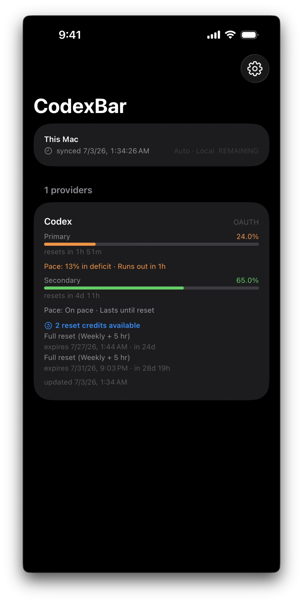
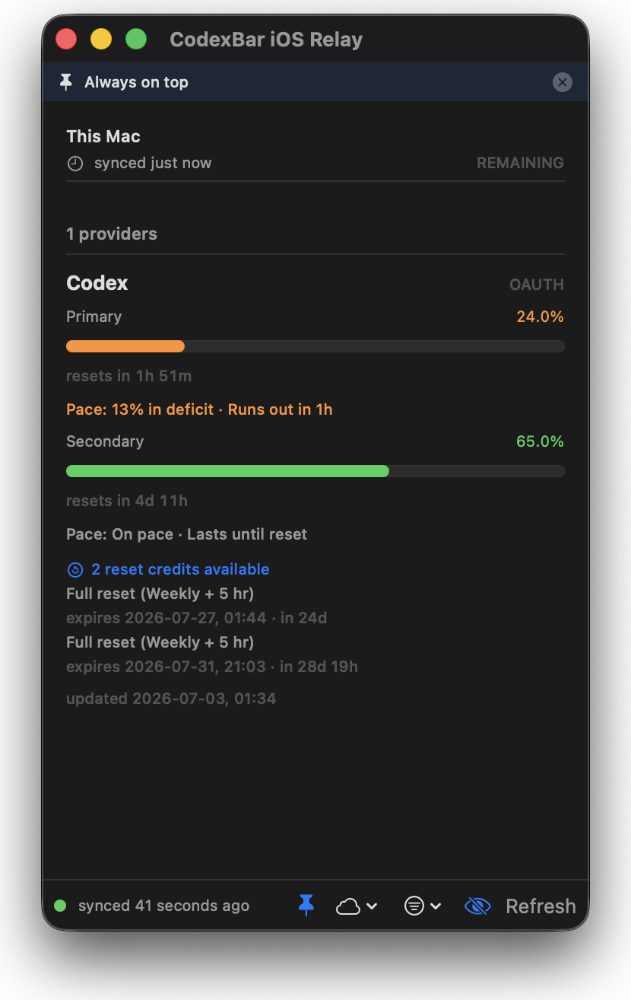

# CodexBar iOS Relay

Shows your [CodexBar](https://github.com/steipete/CodexBar) usage on iPhone by running a small host app on your Mac.

Supports:
- local LAN discovery via Bonjour
- iCloud Drive snapshot sync for iPhone
- CodexBar 0.47.0 iCloud/CloudKit usage snapshots as the Mac-side data source

## Status
- Experimental and not fully tested.
- Use at your own risk.
- Tailscale / remote access is unverified.
- If you run more than one host on the same LAN, the iPhone currently adopts the first Bonjour result it sees.

## Requirements
- CodexBar 0.47.0 or newer on the Mac
- Xcode 26
- Mac and iPhone on the same Wi‑Fi for LAN mode

For the preferred source, enable **CodexBar → Settings → iCloud Sync** and
**Sync usage snapshots** in the signed CodexBar release. The Relay reads
CodexBar's local snapshot cache at:
`~/Library/Application Support/com.steipete.codexbar/sync/engine-state.json`.
It does not access CloudKit directly or sync credentials. The Mac Relay then
writes the resulting, read-only payload to the user-selected iCloud Drive file
so the iPhone app can consume it without a paid developer account.

### Refresh timing

The Mac Relay watches the snapshot files and updates when CodexBar writes new
data, including when it replaces a file atomically. It also rereads the cache
when Relay becomes active or the Mac wakes. The existing 60-second poll remains
as a recovery path; file/focus/wake events never launch extra provider requests.

CodexBar's own snapshot publishing interval still applies (two minutes in
0.74.1). Relay cannot display a measurement before CodexBar publishes it. The
iPhone can additionally lag while iCloud Drive transfers the file.

Unchanged payloads are not rewritten to iCloud Drive. The Mac file footer shows
the age of the oldest known displayed provider measurement, so copying an old
snapshot does not make it look newly measured. A new capture timestamp, even
with unchanged percentages, is still written.

Synthetic refresh checks (no provider calls, app launches or installation):

```sh
swiftc -parse-as-library Shared/Models.swift Shared/ResetCountdown.swift Mac/SnapshotFileWatcher.swift Mac/iCloudDocumentWriter.swift Tests/SnapshotRefreshChecks.swift -o /tmp/relay-refresh-checks && /tmp/relay-refresh-checks
```

## Run
```sh
xcodegen generate
open CodexBarRelay.xcodeproj
```

In Xcode:
1. Change `com.changeme.*` bundle IDs in `project.yml`.
   If you later enable the optional iCloud entitlements, also replace the matching `com.changeme...` IDs in `Mac/CodexBarSyncMac.entitlements` and `iOS/CodexBarSynciOS.entitlements`.
2. Set your signing team in Xcode before building to your devices.
3. Run `CodexBarSyncMac` on your Mac. The relay runs from its window and does not add a menu-bar icon.
4. Pick the same iCloud Drive JSON file once in the Mac Relay and iPhone Relay.
5. Run `CodexBarSynciOS` on your iPhone.

For iPhone installs, you need to pick your own Development Team for the iOS target.

## Screenshots
Turn on **Hide personal information** before taking screenshots. It hides account emails and the host name.

<table>
  <tr>
    <td align="center"></td>
    <td align="center"></td>
  </tr>
</table>
